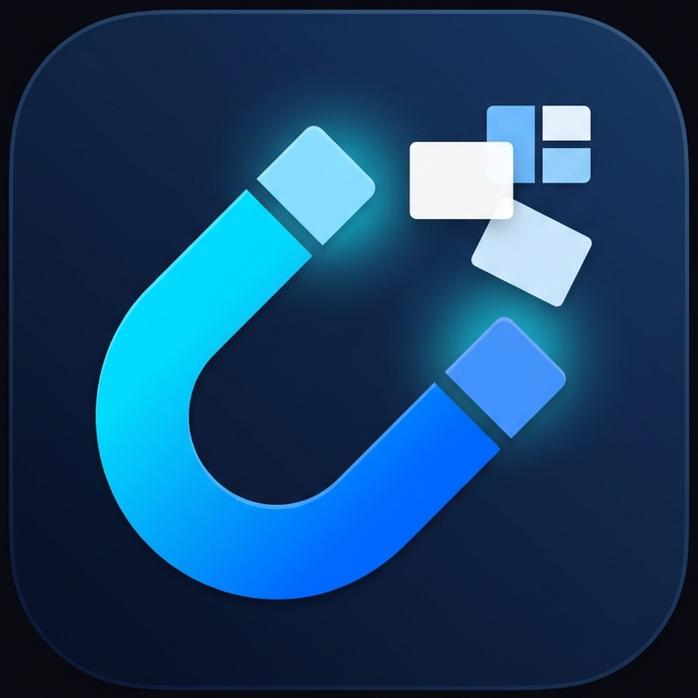
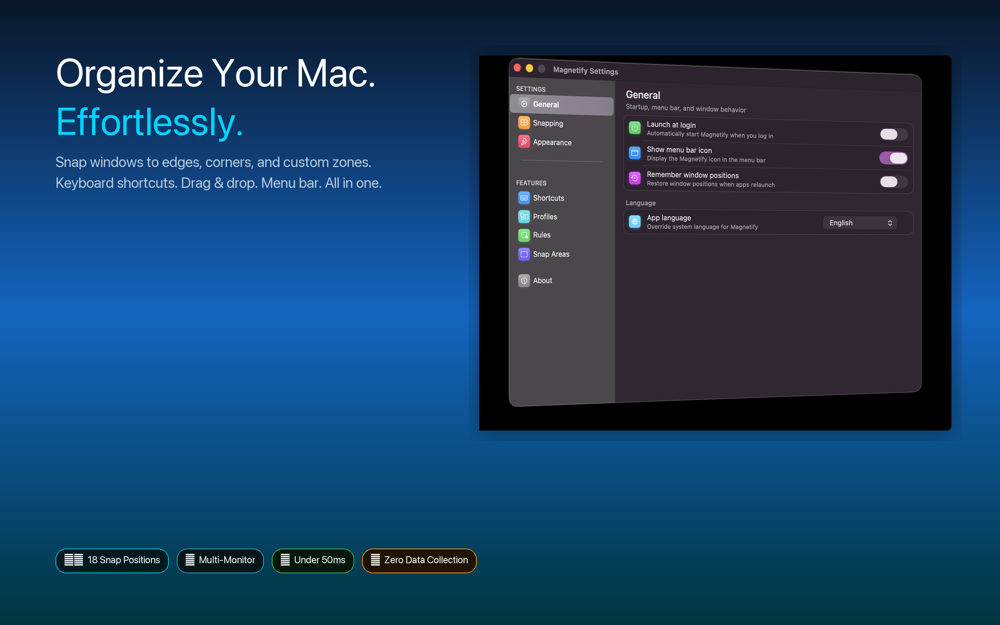
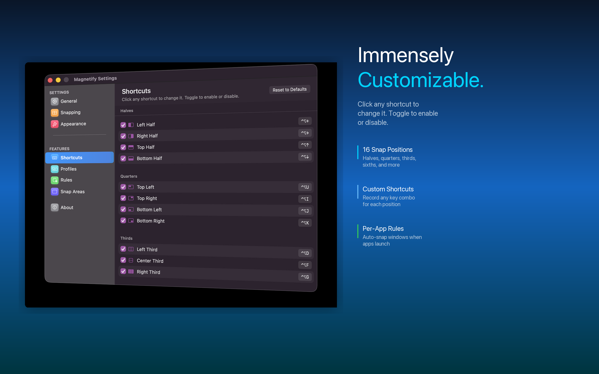
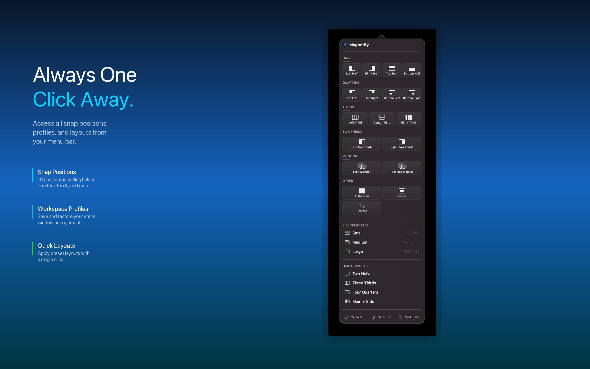
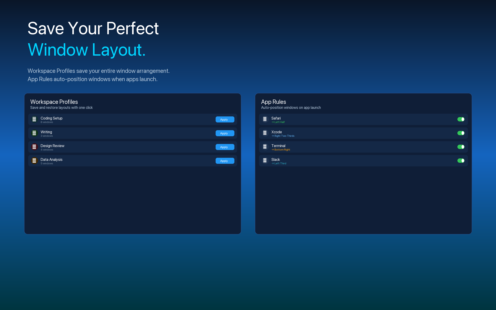

<p align="center">
  
</p>

<h1 align="center">Magnetify</h1>

<p align="center">
  A powerful, lightweight, open-source window manager for macOS.
  <br>
  Snap, tile, and organize your windows effortlessly.
</p>

<p align="center">
  
  
  
</p>

<p align="center">
  
</p>

## Features

### Snap Windows Instantly

16 snap positions out of the box — halves, quarters, thirds, two-thirds, fullscreen, center, and restore. Snap with keyboard shortcuts, drag to screen edges, the menu bar, or the green zoom button.

<p align="center">
  
</p>

### Menu Bar Access

Access all snap positions, workspace profiles, and quick layouts from a single menu bar popover. Always one click away.

<p align="center">
  
</p>

### Workspace Profiles & App Rules

Save and restore entire window arrangements with one click. Auto-position specific apps on launch with priority-based rules.

<p align="center">
  
</p>

### 33 Languages. Zero Data Collection.

Fully localized in 33 languages. No analytics, no tracking, no network requests. Ever.

<p align="center">
  
</p>

### More Features

- **Custom Snap Areas** — Define your own snap zones anywhere on screen
- **Window Memory** — Remember window positions across app restarts
- **Group Snap** — Snap multiple windows at once (2 halves, 3 thirds, 4 quarters)
- **Size Templates** — Pixel or percentage-based custom window sizes
- **iCloud Sync** — Sync settings, profiles, and custom areas across devices
- **Stage Manager Integration** — Works seamlessly with macOS Stage Manager
- **Multi-Monitor Support** — Works across 6+ displays, including vertical screens
- **Smooth Animations** — 60fps Core Animation powered transitions
- **Launch at Login** — Start automatically via SMAppService
- **Accessibility** — VoiceOver labels/hints and Reduce Motion support

## Installation

### Build from Source

```bash
git clone https://github.com/enesgunumdogdu/Magnetify.git
cd Magnetify

# Build without code signing (for testing/development)
xcodebuild -project magnetify.xcodeproj -scheme magnetify -configuration Release build CODE_SIGNING_ALLOWED=NO

# Run tests
xcodebuild -project magnetify.xcodeproj -scheme magnetify -configuration Debug test -destination 'platform=macOS' CODE_SIGNING_ALLOWED=NO
```

### Setup

1. Open `magnetify.xcodeproj` in Xcode
2. In **Signing & Capabilities**, set your `Team` and update the `Bundle Identifier` to your own (e.g. `com.yourname.magnetify`)
3. Build and run (Cmd+R)
4. Copy `magnetify.app` to `/Applications`
5. Go to **System Settings > Privacy & Security > Accessibility** and enable Magnetify

> **Requirements:** macOS 13.0 (Ventura) or later, Xcode 16 or later.

### Why Accessibility Permission?

Magnetify uses the macOS Accessibility API to move and resize windows of other applications. Without this permission, window snapping will not work. The app will prompt you on first launch.

## Architecture

```
magnetify/
├── Core/       # SnapEngine, SnapCalculator, DragManager, ShortcutManager, GroupSnapManager
├── UI/         # MenuBar, Settings (9 panes), Onboarding, Overlay
├── System/     # Accessibility API, Mouse monitors, Screen observer, Stage Manager
├── Storage/    # Settings, Shortcuts, Profiles, Rules, Custom Areas, Templates, iCloud Sync
└── Models/     # SnapPosition, ShortcutBinding, WorkspaceProfile, AppRule, CustomSnapArea
```

## Contributing

Contributions are welcome! Please open an issue or submit a pull request.

1. Fork the repository
2. Create your feature branch (`git checkout -b feature/amazing-feature`)
3. Commit your changes (`git commit -m 'Add amazing feature'`)
4. Push to the branch (`git push origin feature/amazing-feature`)
5. Open a Pull Request

## License

This project is licensed under the MIT License — see the [LICENSE](LICENSE) file for details.
